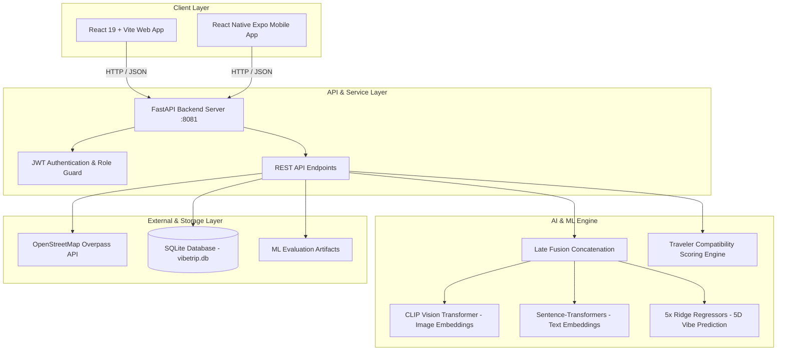
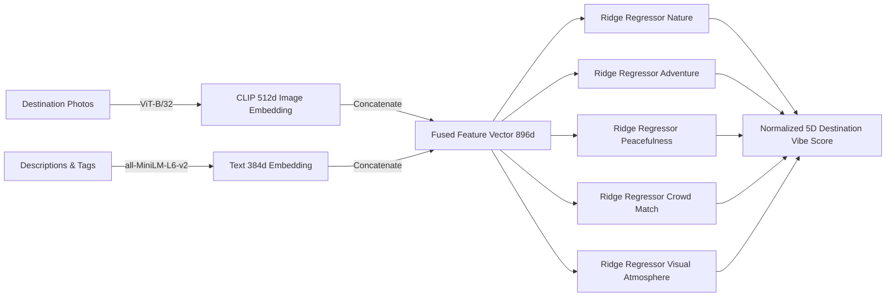
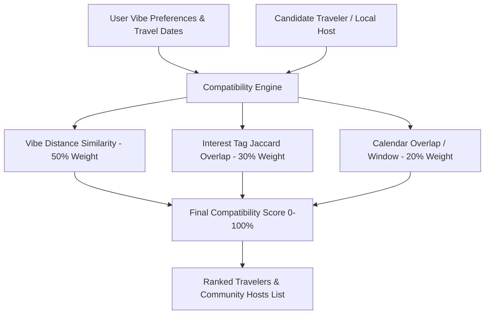

# VibeTrip: Multi-Modal AI Travel Planning & Matching Platform

VibeTrip is a multi-user web application and travel recommendation engine that pairs multi-modal vibe regression (fine-tuned CLIP image embeddings + Sentence-Transformers text embeddings + Ridge regressors) with real geographic place discovery (OpenStreetMap), day-wise vibe-aware itinerary generation, role-based authentication, and compatible traveler discovery.

---

## 📌 Problem Statement

Traditional travel recommendation and planning platforms rely heavily on rigid keywords, generic star ratings, or basic location filters. This leads to critical drawbacks:
1. **Lack of Nuanced Vibe Understanding**: A destination may match a search term like *"nature"* but differ radically in sensory feel—ranging from tranquil solitude to high-adrenaline trekking or crowded tourist hubs.
2. **Disconnected Planning & Companion Discovery**: Travelers typically use separate tools for destination search, day-to-day itinerary planning, local insider discovery, and finding compatible travel buddies.
3. **No Direct Local & Guide Collaboration**: Certified local guides and regional hosts often lack simple direct-contact channels with tourists who share similar travel styles and dates.

**VibeTrip solves this** by leveraging multi-modal deep learning (CLIP visual features + Sentence-Transformers textual embeddings) to quantify destination vibes across 5 dimensions (*Nature, Adventure, Peacefulness, Crowd Level, Visual Atmosphere*), auto-generating day-wise itineraries with real geographic routing, and matching travelers with compatible buddies, verified local hosts, and certified guides.

---

## 🚀 Key Features Implemented

- **🧠 Multi-Modal Vibe Recommendation**: 5D vibe regression using fused CLIP image representations and Sentence-Transformers text embeddings with ridge regression.
- **🗺️ Interactive Place Discovery & Real OSM Points**: Real OpenStreetMap places (cafes, viewpoints, attractions, heritage stays) plotted dynamically with Leaflet maps.
- **📅 Day-Wise Vibe-Aware Itinerary Engine**: Auto-generates balanced multi-day plans categorized by morning, afternoon, and evening activities with real geo-coordinates and transit advisories.
- **👥 Role-Based Authentication & Tailored Experiences**:
  - **Tourists**: Multi-modal vibe search, trip saving, compatible traveler discovery, and date posting.
  - **Locals**: Dedicated community portal to submit hidden gems, review submission statuses, and receive tourist inquiries.
  - **Certified Guides**: Dedicated management of guided trek routes and tours, license badges, and direct inquiry inbox.
  - **Administrators**: Moderation queues, user verification, destination authoring with live AI inference, and Deep Learning metrics dashboard.
- **🤝 Compatible Traveler & Local Host Matching**:
  - **Compatible Travelers Tab**: Multi-factor compatibility matching combining vibe similarity, shared interest tags (Jaccard similarity), and travel date sync.
  - **Locals & Community Hosts Tab**: Direct access to local residents and neighborhood hosts living in each destination.
  - **Post Travel Dates**: Tourists can publish upcoming travel dates and notes to find companions visiting at the same time.
- **🔒 Privacy-Preserving Mutual Connections**:
  - Contact information is strictly protected until mutual connection requests are accepted.
  - Built-in user reporting and blocking mechanism.
- **📊 Deep Learning & ML Metrics Dashboard**:
  - Multiseed stability metrics (10 seeds), ablation studies, cross-validation R² analyses, and residual audits.

---

## 🏗️ System Architecture

### 1. High-Level System Architecture


### 2. Multi-Modal Vibe Regression Pipeline


### 3. Traveler & Buddy Compatibility Matching Pipeline


---

## 1. Quickstart & Installation

### Step 1: Install Dependencies
Ensure Python 3.10+ is installed, then install required packages:
```bash
pip install -r requirements.txt
```

### Step 2: Environment Configuration (.env)
A `.env` file stores secrets without hardcoding passwords in the repository:
```env
JWT_SECRET_KEY=vibetrip-super-secure-production-jwt-token-key-2026-vit
ADMIN_EMAIL=admin@vibetrip.internal
ADMIN_PASSWORD=AdminSecurePass2026!
```

### Step 3: Seed Database & Fetch Real OSM Places
Populate SQLite database `vibetrip.db` with the 50 Indian destinations, photos manifest, vibe scores, OpenStreetMap places, and 15 demo tourist profiles:
```bash
python seed_db.py
```

### Step 4: Create Administrator Account
Create the primary administrator user (reads from `.env` or prompts securely):
```bash
python scripts_db_setup/create_admin.py --email admin@vibetrip.internal
```

### Step 5: Start the Backend Server
Launch the FastAPI production server on port 8081:
```bash
uvicorn backend.main:app --host 0.0.0.0 --port 8081 --reload
```
Once started, visit:
- **Modern React Web App**: [http://localhost:8081/react/](http://localhost:8081/react/) (or `http://localhost:5173` via `npm run dev` in `frontend-react`)
- **Legacy Static Web App**: [http://localhost:8081/app/index.html](http://localhost:8081/app/index.html)
- **Interactive OpenAPI Docs**: [http://localhost:8081/docs](http://localhost:8081/docs)

---

## 2. Frontend Applications

### Modern React Web App (`frontend-react/`)
Built with React 19, Vite, Lucide Icons, and Leaflet OpenStreetMap.
```bash
cd frontend-react
npm install
npm run dev     # Starts Vite dev server at http://localhost:5173
npm run build   # Produces production bundle in frontend-react/dist/
```

### React Native Expo Mobile App (`mobile/`)
Built with React Native, Expo SDK 57, and `@expo/vector-icons` for iOS and Android smartphones.
```bash
cd mobile
npm install
npx expo start  # Launch Expo Dev Server with interactive QR code
```
- Scan the QR code with **Expo Go** on Android or camera on iOS.
- Test in browser directly by pressing `w` (`npx expo start --web`).
- For physical mobile devices, update the Backend Server Host IP in the mobile app's **Profile** screen to your computer's Wi-Fi LAN address (e.g., `http://192.168.x.x:8081`).

---

## 2. Platform Architecture & Key Features

### Role-Based Access Control
- **Tourist**: Browse destinations, filter by multi-modal vibes, generate personalized 3-day plans, save trips, view nearby travelers, and send connection requests.
- **Local Contributor**: Submit authentic local places and experiences (viewpoints, cafes, heritage food spots). Submissions go to a review queue (`status: pending`) and only appear publicly after admin approval.
- **Administrator**: Dedicated login at `/admin/login`. Access to submission queues, user deactivation/reactivation, report reviews, and end-to-end destination creation with real-time AI vibe estimation.

### Security & Privacy Rules
1. **Strict 403 Backend Guard**: Tourists or locals attempting to call `/api/admin/*` or `/api/admin/ml/*` receive HTTP `403 Forbidden`.
2. **Deep Learning Dashboard (`/admin/ml`)**: Admin-only empirical analytics suite powered by Recharts with grouped model comparisons, 10-seed multiseed stability bars, ablation rankings, blocked vs shuffled cross-validation R² metrics, interactive model × query heatmap, 5-dimension predicted vs actual scatter with ±MAE confidence bands, diverging residual audit charts, and documented case studies (e.g. Rishikesh).
3. **Local Place Privacy**: Unapproved local contributor submissions are filtered out from all public searches and destination pages.
4. **Verified Guide Badging**: Certified guides must be explicitly verified by an administrator via `/api/admin/users/{id}/toggle-verify` before displaying the verified badge. Seeded demo guides are explicitly tagged with `Demo Guide Profile`.
5. **Contact Details Protection**: User email and phone/handle are never exposed in public profiles or traveler cards. Contact info is strictly revealed only after a mutual connection request is accepted.
6. **Safety & Blocking**: Blocked users are immediately filtered out from traveler compatibility cards and search results.

---

## 3. Clean Repository Architecture

The project is structured logically for clarity, maintainability, and clean GitHub presentation:

```
Dataset_new_DL/
├── backend/                  # FastAPI web server, PyTorch neural models & auth
├── frontend-react/           # Modern React + Vite web application
├── evaluation_benchmarks/    # Ablation studies, comparative models & empirical ranking scripts
├── scripts_db_setup/         # Database seeding, OSM place ingestion & guides setup
├── archive_experiments/      # Historical experiment logs & intermediate check scripts
├── images/                   # Destination photo datasets
├── vibetrip.db               # Primary SQLite database
├── destinations.csv          # Core destination registry
├── photos_manifest.csv       # Curated photo metadata
├── requirements.txt          # Python runtime dependencies
└── README.md                 # Project documentation
```

---

## 4. Automated Verification Suite
Run the verification suite from `archive_experiments/`:
```bash
python archive_experiments/test_smoke_endpoints.py
python archive_experiments/test_create_destination_e2e.py
```
